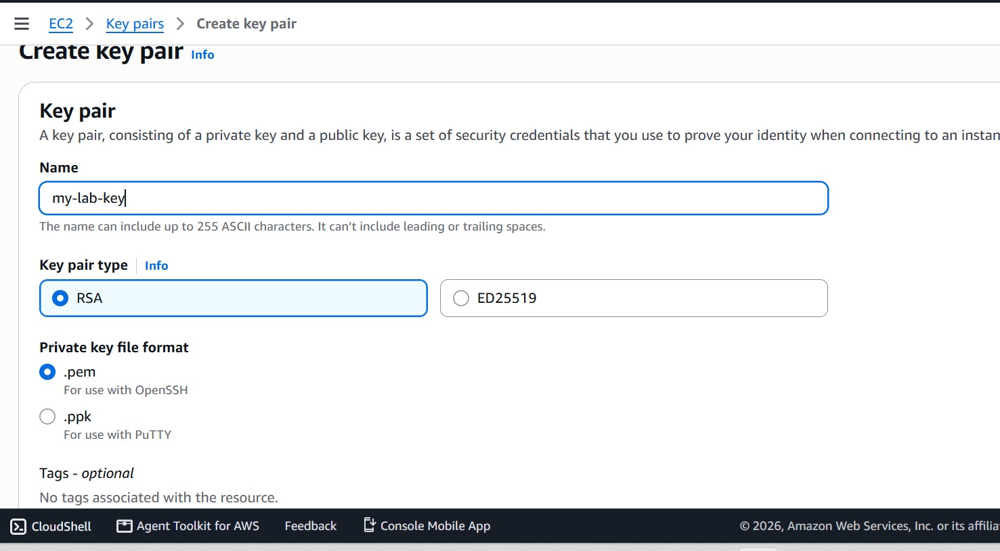
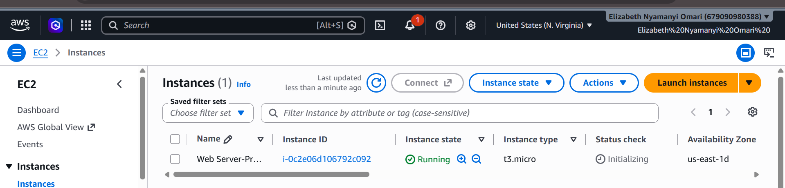
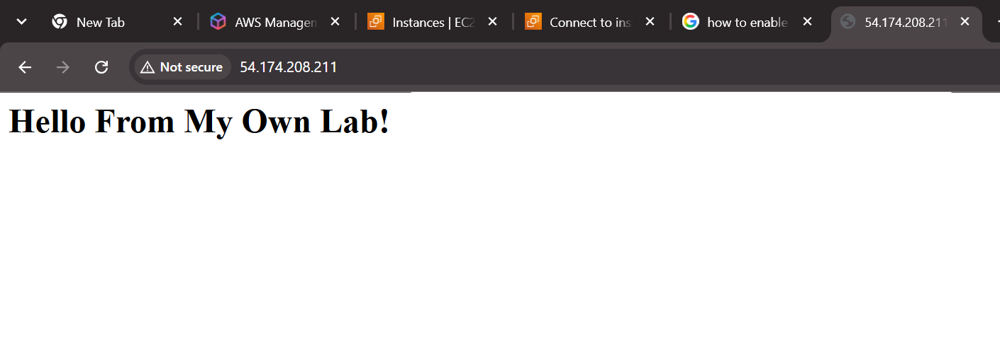
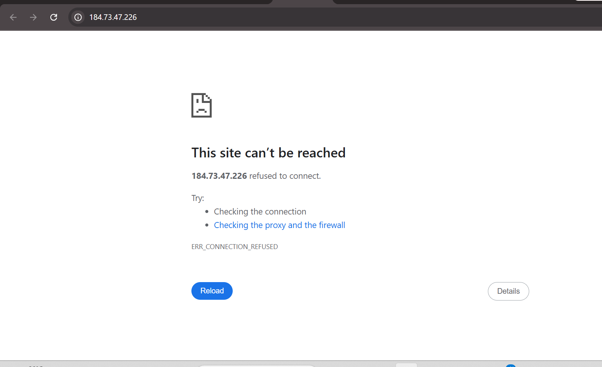
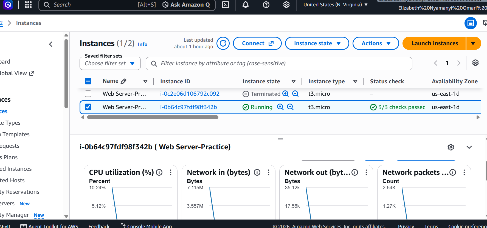
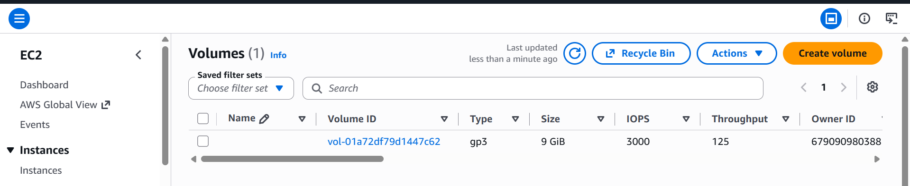
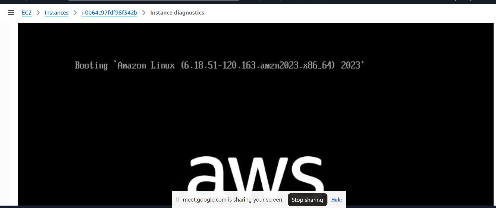

<<<<<<< HEAD
# AWS EC2 Web Server Lab


## 1. Project Overview

This repository documents a hands-on AWS EC2 lab focused on provisioning, configuring, testing, monitoring, and cleaning up a simple web server environment in Amazon Web Services.

The project includes creating an Amazon Linux 2023 instance, configuring a key pair and security group, using EC2 user data to install Apache HTTP Server, validating website accessibility, troubleshooting connectivity issues, and reviewing instance and storage management workflows.

The goal of this project was to build practical experience in cloud infrastructure, Linux administration, networking, monitoring, troubleshooting, and cost awareness.

## 2. Objectives

- Provision an EC2 instance in the AWS US East (N. Virginia) region.
- Create an RSA key pair for secure instance access.
- Configure security-group rules for SSH and HTTP.
- Deploy Apache using an initialization script.
- Host and test a basic HTML webpage.
- Review instance status checks and monitoring metrics.
- Investigate SSH and web-server connectivity problems.
- Practice EC2 instance resizing and EBS volume modification workflows.
- Terminate the instance and review remaining resources.

## 3. AWS Services and Tools

| Service or Tool | Purpose |
|---|---|
| Amazon EC2 | Virtual server provisioning and management |
| Amazon Linux 2023 | Server operating system |
| EC2 key pair | Key-based SSH authentication |
| EC2 security group | Inbound network traffic control |
| Apache HTTP Server | Hosting the webpage |
| Amazon EBS | Persistent block storage |
| EC2 user data | Initial server configuration |
| cloud-init | Processing initialization scripts |
| Amazon CloudWatch | Instance monitoring metrics |
| AWS Management Console | Managing cloud resources |
| Visual Studio Code | Editing scripts and documentation |

## 4. Lab Configuration

| Setting | Configuration |
|---|---|
| AWS Region | US East (N. Virginia) |
| Region code | `us-east-1` |
| Initial instance name | `Web Server-Practice` |
| Initial instance type | `t3.micro` |
| Target instance type | `t3.small` |
| Amazon Machine Image | Amazon Linux 2023 |
| Key pair | `my-lab-key` |
| Security group | `Web Server SG` |
| Initial EBS volume | 8 GiB, gp3 |
| Target EBS volume | 10 GiB |
| Web server | Apache HTTP Server |
| HTTP port | TCP 80 |
| SSH port | TCP 22 |

The `t3.small` instance type and 10 GiB volume were target settings in the lab procedure. They should only be described as completed changes if the modifications were successfully applied and verified.

## 5. Architecture

```text
                       Internet
                          |
                          | HTTP - TCP 80
                          v
                  EC2 Security Group
                          |
                          v
                  Amazon EC2 Instance
                  Amazon Linux 2023
                          |
                          v
                  Apache HTTP Server
                          |
                          v
                     index.html
```

SSH management traffic uses TCP port 22. Website traffic uses TCP port 80. The two ports have separate security-group rules.

---

## Step 0: Environment Setup

I began by accessing the AWS Management Console and selecting the required AWS region.

### Procedure

1. Sign in to the AWS Management Console.
2. Open the EC2 Dashboard.
3. Select **US East (N. Virginia) — `us-east-1`**.
4. Review the EC2 dashboard before creating resources.
5. Confirm the intended instance and storage configurations.

The original lab guide identified `t3.micro` as the initial instance type and `t3.small` as the target for the resizing exercise.

**Cost consideration:** AWS Free Tier eligibility and credits depend on the account, applicable offer, service, and usage. Always check the current billing dashboard before launching resources.

## Step 1: Create the EC2 Key Pair

I created an RSA key pair named `my-lab-key` for the lab.

### Procedure

1. Navigate to **EC2 → Network & Security → Key Pairs**.
2. Select **Create key pair**.
3. Enter `my-lab-key` as the name.
4. Select **RSA** as the key-pair type.
5. Select the `.pem` format.
6. Create the key pair.
7. Save the downloaded private key securely.

### Screenshot: Key pair creation



The private key is used for SSH authentication where applicable.

**Security:** Never upload `my-lab-key.pem` to GitHub or include it in the project repository.

## Step 2: Create the Security Group

I configured a security group named `Web Server SG` to control inbound access to the EC2 instance.

### Procedure

1. Navigate to **EC2 → Network & Security → Security Groups**.
2. Select **Create security group**.
3. Enter `Web Server SG` as the security group name.
4. Enter `Allow SSH and HTTP` as the description.
5. Select the Default VPC.
6. Configure the inbound rules.
7. Create the security group.

### Inbound rules

| Type | Port | Source | Purpose |
|---|---:|---|---|
| SSH | TCP 22 | My IP (`/32`) initially | Remote administration |
| HTTP | TCP 80 | Anywhere-IPv4 (`0.0.0.0/0`) | Public website access |

### Screenshot: Security-group configuration


### Security and troubleshooting note

During the lab, I experienced SSH access problems because the My IP rule can become outdated when a public IP address changes. I temporarily changed the SSH source to Anywhere-IPv4 while troubleshooting.

SSH should normally be restricted to a trusted current public IP address or an appropriately managed access method. Opening port 22 to the entire internet should not be left enabled unnecessarily.

The SSH rule is separate from the HTTP rule, so changing the SSH source does not normally resolve a website connection-refused error.

## Step 3: Launch the EC2 Instance

I launched the EC2 instance using Amazon Linux 2023 and configured it to use the key pair and security group created in the previous steps.

### Procedure

1. Navigate to **EC2 → Instances → Launch instances**.
2. Enter `Web Server-Practice` as the instance name.
3. Select an Amazon Linux 2023 Amazon Machine Image.
4. Choose `t3.micro` as the initial instance type.
5. Select the `my-lab-key` key pair.
6. Select the Default VPC.
7. Enable automatic assignment of a public IPv4 address.
8. Select the existing `Web Server SG` security group.
9. Configure one 8 GiB gp3 EBS volume.
10. Open **Advanced details → User data**.
11. Paste the initialization script below.
12. Launch the instance.

### Screenshot: Creating the instance


### EC2 user-data script

The following script was specified in the lab procedure to install Apache and create the webpage.

```bash
#!/bin/bash

yum -y install httpd

systemctl enable httpd
systemctl start httpd

echo '<h1>Hello From My Own Lab!</h1>' > /var/www/html/index.html
```

### Script explanation

- `yum -y install httpd` installs Apache HTTP Server.
- `systemctl enable httpd` enables Apache to start automatically at boot.
- `systemctl start httpd` starts the Apache service.
- The final command writes the HTML page to `/var/www/html/index.html`.

The script is also documented in the project as `scripts/userdata.sh`.

### Screenshot: Instance initialization



### Screenshot: Instance status checks


The original lab guide instructed waiting for the instance to reach the Running state and for status checks to pass. The console screenshot should be used to show the status that was actually reached.

**Troubleshooting note:** During the lab, the instance console showed a cloud-init warning about the user scripts. This indicated that initialization required further investigation.

Useful diagnostic commands, when connected to the instance, include:

```bash
sudo cloud-init status --long
```

```bash
sudo cat /var/log/cloud-init-output.log
```

```bash
sudo systemctl status httpd
```

Passing EC2 status checks alone does not prove that Apache is serving the webpage.

## Step 4: Test and Verify the Website

After launching the instance, I tested access to the webpage using the instance's public IPv4 address.

### Procedure

1. Open **EC2 → Instances**.
2. Select `Web Server-Practice`.
3. Copy its current public IPv4 address.
4. Open a web browser.
5. Enter the address using the HTTP URL format below.

```text
http://PUBLIC-IP-ADDRESS
```

The expected webpage content was:

**Hello From My Own Lab!**

### Screenshot: Successful website



The website initially returned a connection-refused error during the lab. After troubleshooting, the webpage was accessible.
### Screenshot: Troubleshooting



### Lessons from troubleshooting

- A My IP rule may become outdated when the public IP address changes.
- SSH uses TCP port 22, while HTTP uses TCP port 80.
- An HTTP connection-refused error can indicate that Apache is not listening or running.
- User-data and cloud-init logs should be checked when automatic setup fails.
- The current public IP address should be verified in the EC2 console.
### SSH connection test (optional)

The original lab guide also included an optional SSH test:

```bash
chmod 400 my-lab-key.pem
ssh -i my-lab-key.pem ec2-user@PUBLIC-IP-ADDRESS
```

Replace `PUBLIC-IP-ADDRESS` with the instance's current public IP address. Run these commands from a compatible terminal where the private key is stored.

SSH access requires the correct private key, a reachable instance, an appropriate security-group rule, and an SSH client.


## Step 5: Monitor the EC2 Instance

The original procedure included reviewing EC2 monitoring metrics and inspecting the instance's boot status.

### A. Review monitoring metrics

1. Navigate to **EC2 → Instances**.
2. Select the instance.
3. Open the **Monitoring** tab.
4. Review the available CloudWatch metrics.

### Screenshot: Monitoring



Monitoring helps administrators review metrics such as CPU utilization and identify possible performance issues.

### B. Inspect the instance screenshot

The lab guide also instructed using the EC2 console's instance screenshot feature.

1. Select the instance.
2. Open **Actions → Monitor and troubleshoot → Get instance screenshot**, where available.
3. Inspect the displayed boot information for possible startup issues.

This can help investigate boot problems, but it is not a replacement for reviewing cloud-init and application logs.

## Step 6: Resize the Instance and EBS Volume

The original lab procedure specified changing the instance type from `t3.micro` to `t3.small` and increasing the EBS volume from 8 GiB to 10 GiB.

These are separate operations and should be verified independently.

### A. Change the EC2 instance type

1. Stop the instance.
2. Wait until the instance state shows **Stopped**.
3. Navigate to **Actions → Instance settings → Change instance type**.
4. Select `t3.small`.
5. Apply the change.
6. Start the instance again.

### B. Modify the EBS volume

1. Navigate to **EC2 → Elastic Block Store → Volumes**.
2. Select the volume attached to the instance.
3. Choose **Actions → Modify volume**.
4. Enter `10 GiB` as the new size.
5. Submit the modification.
6. Check the modification status and resulting volume size.

### Screenshot: Volume adjustment



Increasing an EBS volume is generally an expansion operation. Additional steps may be required inside the operating system to extend a partition or filesystem, depending on the volume layout.

**Verification:** A screenshot of the adjustment screen alone does not establish that the new volume size was applied. Confirm the final size in the EC2 console before documenting it as completed.

### C. Snapshot evidence

EBS snapshots can provide point-in-time backups of volumes.



Verify the snapshot status in the AWS console before claiming that a completed snapshot was created.

## Step 7: Clean Up AWS Resources

The final step in the lab was to terminate the EC2 instance and review remaining resources to avoid unnecessary charges.

### Procedure

1. Stop the instance if it is still running.
2. Navigate to **Instance state → Terminate instance**.
3. Confirm termination.
4. Navigate to **EC2 → Volumes**.
5. Review remaining EBS volumes and delete unused volumes when safe.
6. Review any EBS snapshots.
7. Delete the `my-lab-key` key pair from AWS if it is no longer needed.
8. Review AWS Billing and Cost Management.

### Cleanup considerations

- Terminating an instance does not necessarily remove every associated resource.
- EBS volumes and snapshots may incur charges if retained.
- Deleting a key pair from AWS does not erase private-key copies already downloaded to a computer.
- Check resource status and billing after completing the lab.

The EC2 instance used for this lab was terminated.

## 8. Troubleshooting Summary

| Issue | Investigation | Lesson |
|---|---|---|
| SSH connection failure | Reviewed the SSH source rule and current public IP | A My IP rule can become outdated |
| Initial website connection refused | Investigated website availability and server setup | An open HTTP rule does not guarantee Apache is running |
| cloud-init user-script warning | Identified the need to inspect initialization logs | Automated setup should be verified |
| Public IP address changes | Checked the current address in the EC2 console | Do not assume a public IP remains unchanged |
| Volume adjustment | Reviewed the EBS modification workflow | Verify the final volume size |
| Resource cleanup | Terminated the instance and reviewed remaining resources | Storage and snapshots must also be checked |

## 9. Project Structure

```text
aws-ec2-web-server-lab/
├── README.md
├── docs/
├── screenshots/
│   ├── adjusting_volume.png
│   ├── create instance.png
│   ├── failed.png
│   ├── image.png
│   ├── intializing.png
│   ├── keypair.png
│   ├── monitoring.png
│   ├── passed instancce.png
│   ├── security group.png
│   ├── snap.png
│   └── success.png
├── scripts/
│   └── userdata.sh
└── .gitignore
```

## 10. Key Learnings

This lab strengthened my understanding of:

- EC2 provisioning and instance lifecycle management.
- Linux-based web-server deployment.
- SSH authentication and security-group configuration.
- HTTP connectivity and public IP addressing.
- Apache service management.
- User-data automation and cloud-init troubleshooting.
- EC2 monitoring and instance diagnostics.
- EBS volume management and snapshots.
- AWS resource cleanup and cost awareness.

## 11. Future Improvements

Possible improvements for a future iteration include:

- Restricting SSH access to a trusted IP address or using a managed access method.
- Automating checks for Apache and cloud-init status.
- Configuring HTTPS with a valid TLS certificate.
- Creating CloudWatch alarms.
- Automating infrastructure deployment with AWS CloudFormation or Terraform.
- Verifying and documenting completed instance and storage changes.
- Developing a more complete webpage and configuring a custom domain.

## 12. Conclusion

This project provided hands-on practice with AWS EC2, Amazon Linux 2023, Apache HTTP Server, security groups, monitoring, and cloud troubleshooting.

It demonstrated the importance of verifying infrastructure and application health separately, using secure remote access, investigating initialization problems, and cleaning up cloud resources after a lab.

The experience supports my continued development in cloud infrastructure, Linux administration, networking, and entry-level cloud engineering.

## Security Notice

This repository is for educational and portfolio purposes.

Never upload private `.pem` keys, AWS credentials, passwords, access tokens, or other sensitive information. Review screenshots before publishing to ensure confidential account information is not exposed.

**Author:** Elizabeth Omari  
**Project:** AWS EC2 Web Server Lab  
**Focus Areas:** Cloud Infrastructure, Linux, Networking, Monitoring, and Troubleshooting
=======
# aws_restart.
Mycloud Starting point 
>>>>>>> bdb25191b346d5c7912964b78410783542cd9650
